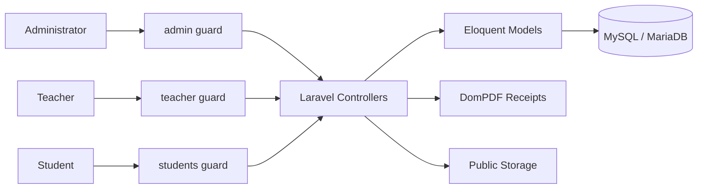

# E-Learning Management System (LMS)

[](https://github.com/ra1ya/E-Learning-Management-System/actions/workflows/ci.yml)
[](https://laravel.com/)
[](https://www.php.net/)
[](LICENSE)

A multi-role **Learning Management System** built with Laravel 11, PHP 8.2+, MySQL/MariaDB, Blade, and Vite. The project demonstrates practical backend engineering through separate administrator, teacher, and student workflows, enrollment-based authorization, assessments, payments, PDF receipts, relational data design, automated testing, and CI verification.

The portfolio emphasis is **Laravel architecture, backend workflows, access control, and data integrity** rather than visual complexity.

## Recruiter Snapshot

- Multi-guard authentication for `admin`, `teacher`, and `students`
- Enrollment-based authorization for student courses, homework, and tests
- Assessment submissions tied to the authenticated student identity
- Question-to-assessment ownership validation to prevent cross-assessment submissions
- Protected administrator workflows for students, teachers, courses, batches, enrollments, payments, and PDF receipts
- Validated CRUD flows and Laravel password hashing
- Sanitized demo database plus repeatable demo seeding
- Full GitHub Actions pipeline covering install, migrations, seeders, routes, tests, PHP syntax, and frontend production build

## Architecture



For a deeper technical walkthrough, see [`docs/ARCHITECTURE.md`](docs/ARCHITECTURE.md). Security controls and production expectations are documented in [`SECURITY.md`](SECURITY.md).

## Core Features

### Administrator

- Manage students and teachers
- Manage courses and batches
- Manage enrollments and payments
- Generate protected PDF payment receipts
- Update account profile and password

### Teacher

- Manage courses
- Create and manage homework and tests
- Manage assessment questions
- Review student homework and test submissions
- Manage student results
- Update account profile and password

> **Portfolio scope:** teacher accounts are treated as trusted instructional staff with shared course-management access. Per-teacher course ownership is intentionally outside this demo's scope and is not advertised as implemented.

### Student

- Dedicated registration and authentication
- Access enrolled courses only
- Access homework and tests only for enrolled courses
- Submit homework and test answers
- View only personal answer details and results
- Update account profile and password

## Security and Data Integrity

- Public administrator and teacher self-registration is disabled
- Payment reports require administrator authentication
- Student submissions derive identity from the authenticated student guard
- Homework/test questions must belong to the selected assessment
- Students cannot access assessments outside their enrolled courses
- Student answer detail pages are scoped to the authenticated student
- Protected CRUD requests validate accepted fields instead of trusting raw request payloads
- Passwords are hashed using Laravel facilities
- Demo data is fictional and sanitized

## Tech Stack

- **Backend:** PHP 8.2+, Laravel 11
- **Database:** MySQL / MariaDB
- **Frontend:** Blade, HTML, CSS, JavaScript, Vite
- **ORM:** Eloquent
- **PDF:** DomPDF
- **Testing:** PHPUnit / Laravel Feature Tests
- **CI:** GitHub Actions

## Project Structure

```text
app/
├── Http/Controllers/
│   ├── Admin/
│   ├── Teacher/
│   └── Students/
└── Models/

database/
├── migrations/
├── seeders/
└── sample/
    └── dblearnn_demo.sql

docs/
└── ARCHITECTURE.md

resources/
└── views/

routes/
├── web.php
├── admin-auth.php
├── teacher-auth.php
└── students-auth.php

tests/
└── Feature/
    └── LmsSecurityTest.php
```

## Local Setup

### Requirements

- PHP 8.2+
- Composer
- Node.js 20+
- npm
- MySQL / MariaDB, or SQLite for automated tests

### Install

```bash
git clone https://github.com/ra1ya/E-Learning-Management-System.git
cd E-Learning-Management-System
composer install
npm install
cp .env.example .env
php artisan key:generate
```

Configure database credentials in `.env`, then choose one database setup method.

### Option A — Fresh database with demo seed

```bash
php artisan migrate:fresh --seed
```

### Option B — Sanitized MySQL demo dump

```bash
mysql -u YOUR_DB_USER -p YOUR_DB_NAME < database/sample/dblearnn_demo.sql
```

Create the public storage link for uploaded course PDFs:

```bash
php artisan storage:link
```

Run the application:

```bash
npm run dev
php artisan serve
```

## Automated Verification

The CI workflow verifies the repository from a clean environment with:

```text
composer validate
composer install
PHP syntax linting
php artisan migrate:fresh --seed
php artisan route:list
php artisan test
npm ci
npm run build
```

This gives reviewers a reproducible technical signal instead of relying only on screenshots or manual setup claims.

## Demo Database

A sanitized SQL sample is available at:

```text
database/sample/dblearnn_demo.sql
```

The sample contains fictional administrator, teacher, student, course, assessment, enrollment, payment, and result data. It does not contain production credentials or session payloads.

Demo password for seeded/demo accounts:

```text
password
```

## What This Project Demonstrates

This repository is intended to demonstrate practical experience with:

- Laravel MVC architecture
- Multi-guard authentication
- Authorization and access-boundary design
- Eloquent relationships and relational database modeling
- Enrollment-driven LMS workflows
- Assessment submission and grading logic
- File uploads and PDF generation
- Request validation and secure record access
- Automated testing and CI/CD fundamentals
- Reproducible local setup and database seeding

## License

This project is available under the MIT License. See [`LICENSE`](LICENSE).

## Author

**Rian Aldini**  
Full-Stack Web & Mobile Developer  
Laravel • PHP • MySQL • Flutter

LinkedIn: https://www.linkedin.com/in/rian-aldini-353102329
