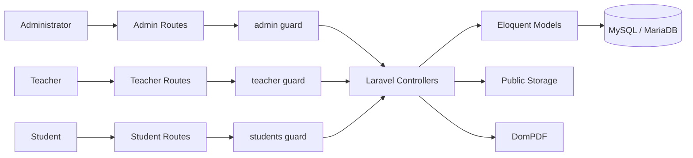
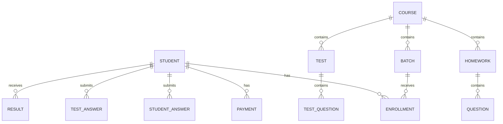
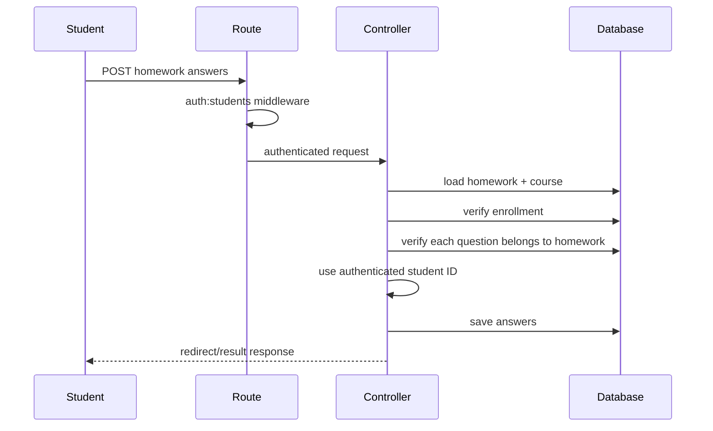

# Architecture Overview

This document explains the technical structure of the portfolio LMS and the boundaries that are intentionally enforced in the application.

## System Shape



The application is a server-rendered Laravel system. Authentication is separated by guard, while authorization rules are enforced at route/controller level for the portfolio scope.

## Role Boundaries

| Capability | Administrator | Teacher | Student |
| --- | :---: | :---: | :---: |
| Manage students | Yes | Read-only workflow | No |
| Manage teachers | Yes | No | No |
| Manage courses | Yes | Yes | Enrolled only |
| Manage batches | Yes | No | No |
| Manage enrollments | Yes | No | No |
| Manage payments | Yes | No | No |
| Generate payment receipt | Yes | No | No |
| Create homework/tests | No | Yes | No |
| Review assessment answers | No | Yes | Personal only |
| Submit homework/tests | No | No | Enrolled courses only |
| View results | No | Yes | Personal only |

Teacher accounts are treated as trusted instructional staff with shared course-management access in this demo. Per-teacher ownership is intentionally outside the current portfolio scope.

## Core Domain Relationships



The enrollment relation is used as the authorization boundary for student course and assessment access. A student is not allowed to open or submit work for an unrelated course merely by changing an identifier in the request.

## Request Flow Example — Student Homework Submission



The important design choice is that student identity comes from the authenticated guard instead of a client-supplied `student_id` value.

## Security-Relevant Decisions

- Administrator and teacher self-registration are not exposed publicly.
- Payment receipts require administrator authentication.
- Student answer detail access is scoped to the authenticated student.
- Homework and test access is restricted by enrollment.
- Submitted question IDs must belong to the selected assessment.
- CRUD endpoints validate accepted fields instead of trusting raw request payloads.
- Passwords are stored using Laravel hashing facilities.
- Published demo data is fictional and sanitized.

## Automated Verification

GitHub Actions verifies the project on pushes and pull requests by running:

```text
composer validate
PHP syntax linting
php artisan migrate:fresh --seed
php artisan route:list
php artisan test
npm ci
npm run build
```

This validates that the repository can be installed, migrated, seeded, tested, and built from a clean CI environment.
